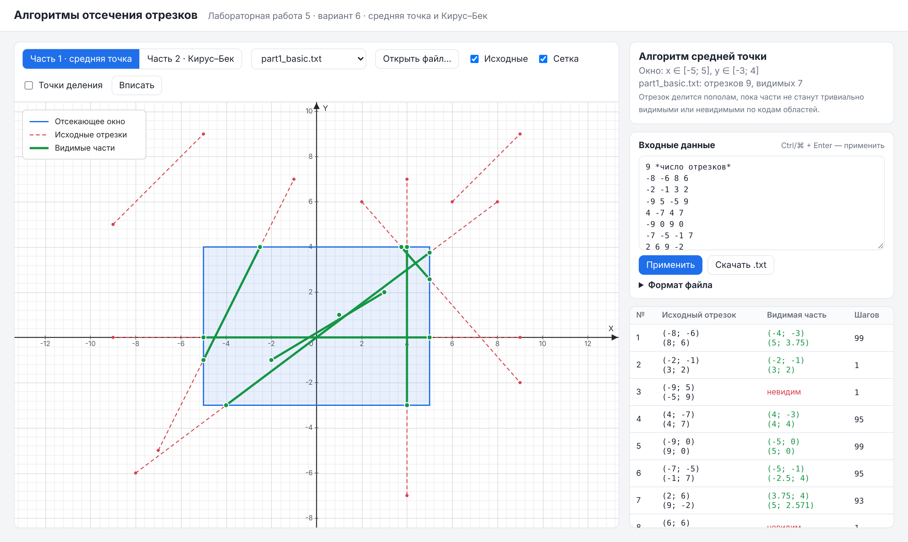
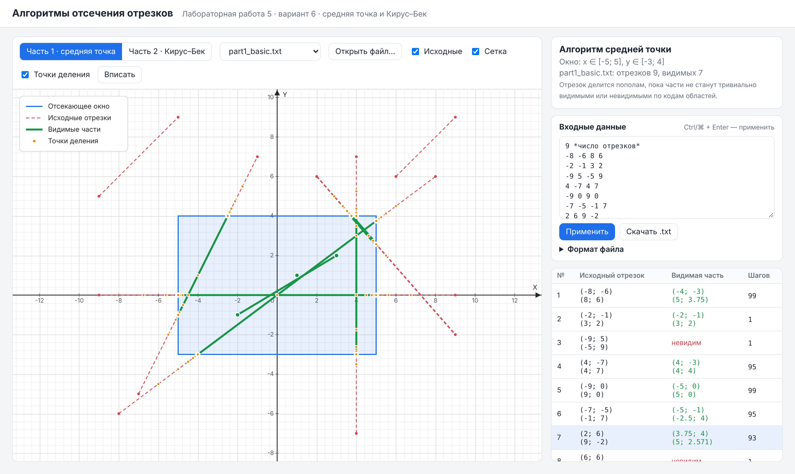
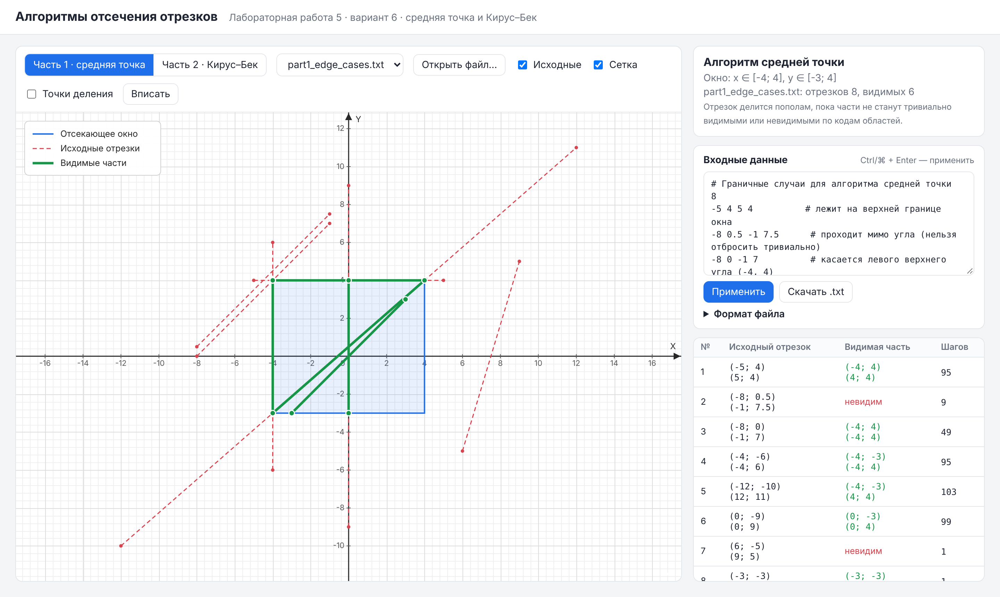
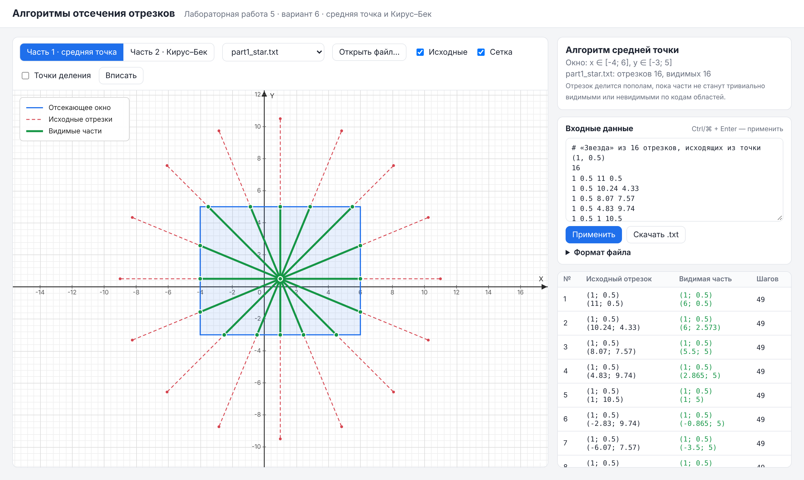
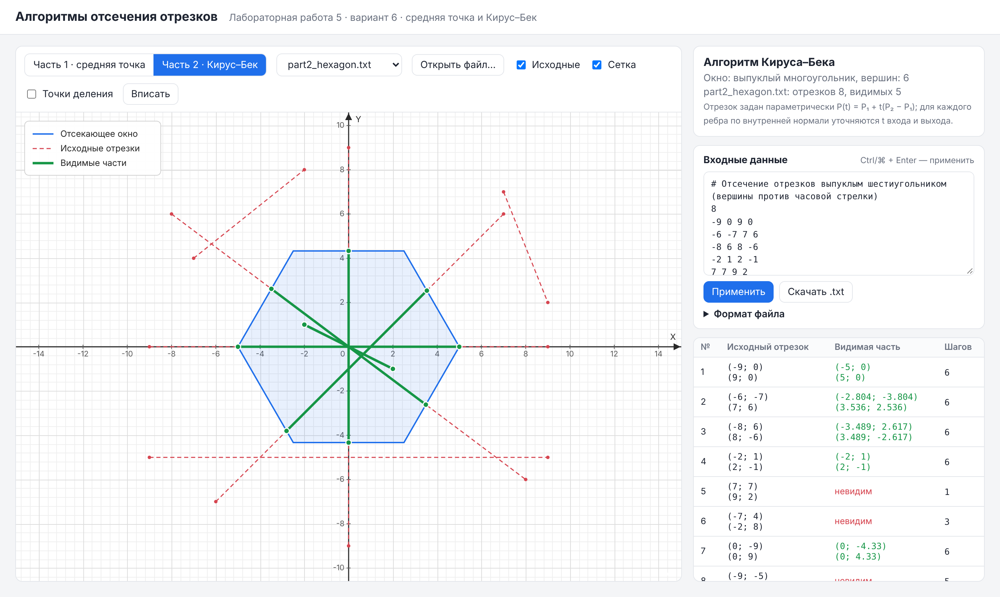
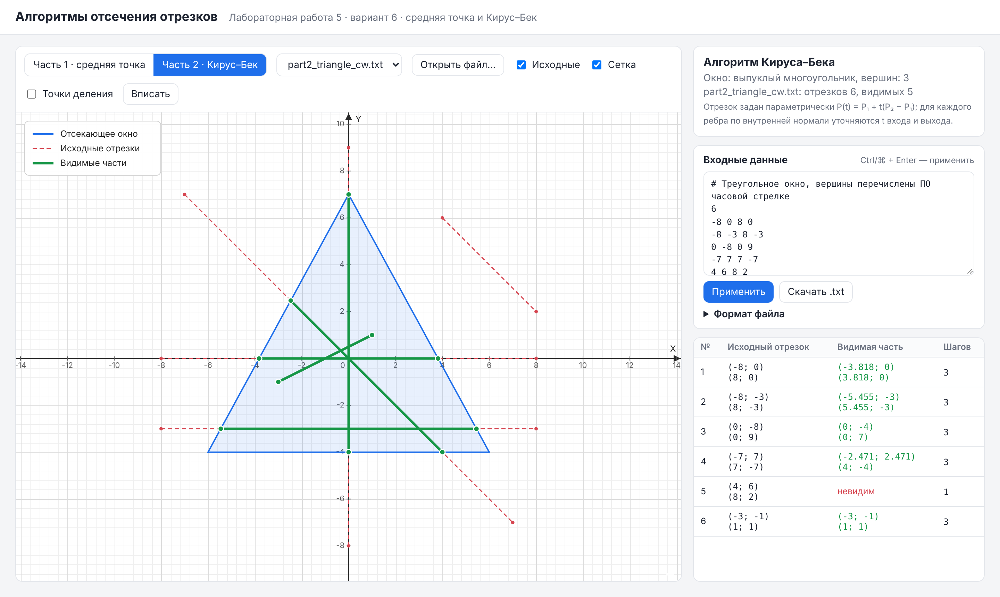
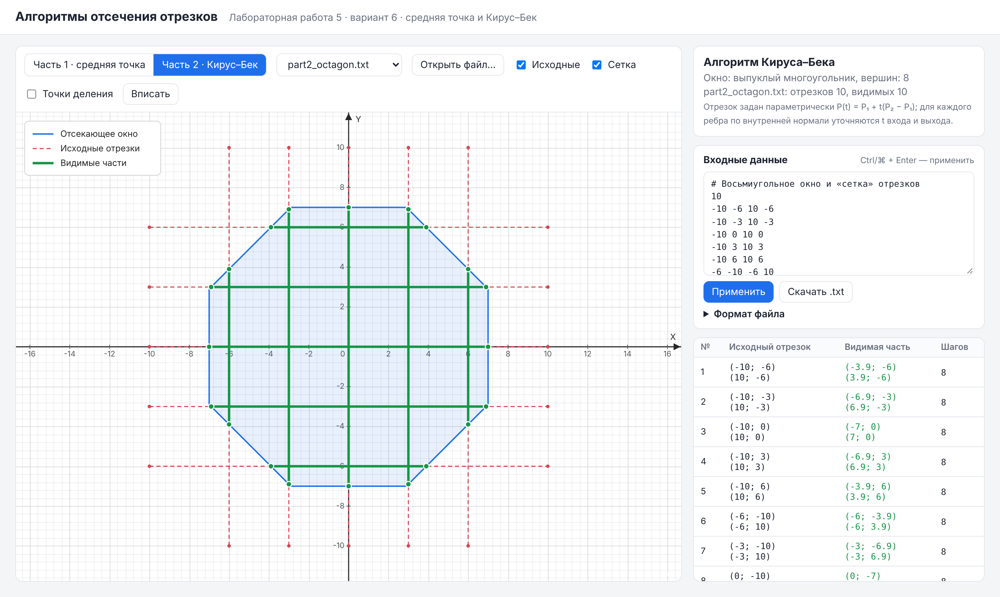
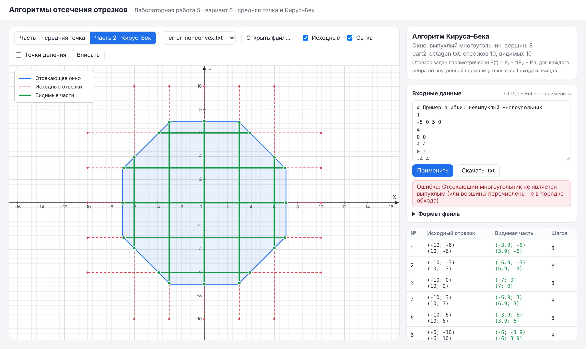

# Лабораторная работа 5 — алгоритмы отсечения отрезков

Вариант 6. **Приложение на C++17 / Qt 6** и **веб-версия** показывают, как работают:

| Часть | Окно | Алгоритм |
|---|---|---|
| 1 | прямоугольник | **Алгоритм средней точки** |
| 2 | выпуклый многоугольник | **Алгоритм Кируса–Бека** (отсечение отрезков выпуклым многоугольником) |

**Веб-версия (работает в любом браузере на Windows и macOS):**
https://annagalimskaa-byte.github.io/Anna_Galimskaya_13_PCG/lab5_web/ — папка [`lab5_web`](../lab5_web).
Её же можно открыть локально двойным щелчком по `lab5_web/index.html`.

## Описание работы

### Цель
Закрепить теорию и на практике освоить основные методы и алгоритмы отсечения отрезков и многоугольников.

### Задача
Написать приложение, которое:
- выводит систему координат в подходящем масштабе;
- рисует отсекающее окно одним цветом, а исходные отрезки другим;
- выполняет отсечение алгоритмами своего варианта;
- показывает видимые части отрезков.

### Коды областей
Продолжения сторон прямоугольного окна делят плоскость на 9 областей. Каждой точке присваивается
4-битный код: «левее», «правее», «ниже», «выше» окна (`0000` — точка внутри).
По кодам концов отрезка сразу решаются два тривиальных случая:
- `code1 | code2 == 0`: оба конца внутри, отрезок **целиком видим**;
- `code1 & code2 != 0`: оба конца по одну внешнюю сторону, отрезок **целиком невидим**.

### Часть 1. Алгоритм средней точки
Точки пересечения не вычисляются по формулам, а находятся **делением отрезка пополам**
(`M = (P1 + P2) / 2`), то есть двоичным поиском:

1. Вычислить коды концов отрезка AB.
2. Если отрезок тривиально видим, добавить его к результату; если тривиально невидим, отбросить.
3. Если длина AB меньше точности ε, остановиться: видимым считается конец (или середина), лежащий в окне.
4. Иначе найти середину M и рекурсивно обработать AM и MB.

Окно выпукло, поэтому видимые куски идут подряд, и результатом будет отрезок от начала первого
до конца последнего видимого куска. Глубина рекурсии ≈ log₂(L/ε); при ε = 10⁻⁷·(размер окна)
на один отрезок уходит порядка 50–100 делений (столбец «Шагов» в таблице результатов).

### Часть 2. Алгоритм Кируса–Бека
Отрезок задаётся параметрически: `P(t) = P1 + t·(P2 − P1)`, `0 ≤ t ≤ 1`.
Для каждого ребра окна с вершиной `Vi` берётся **внутренняя нормаль** `n`. Знак `n·(P(t) − Vi)`
показывает, где лежит точка: `> 0` — внутри, `< 0` — снаружи. Из условия `n·(P(t) − Vi) = 0`:

```
t = −n·(P1 − Vi) / n·(P2 − P1)
```

- знаменатель `= 0`: отрезок параллелен ребру; если он снаружи, то целиком невидим;
- знаменатель `> 0`: точка входа, `tL = max(tL, t)`;
- знаменатель `< 0`: точка выхода, `tU = min(tU, t)`.

Если `tL > tU`, отрезок невидим, иначе видимая часть — от `P(tL)` до `P(tU)`.
Направление обхода вершин определяется по знаку ориентированной площади, поэтому вершины можно
задавать и по часовой, и против часовой стрелки. При загрузке проверяется, что многоугольник выпуклый.

### Результаты

| Часть 1: средняя точка | Часть 1: точки деления (выделен отрезок № 7) |
|---|---|
|  |  |
| **Граничные случаи** (на границе, касание угла, проход мимо угла) | **Пучок отрезков из точки внутри окна** |
|  |  |
| **Часть 2: шестиугольное окно** | **Треугольник, вершины по часовой стрелке** |
|  |  |
| **Восьмиугольное окно** | **Ошибка: невыпуклый многоугольник** |
|  |  |

Пример для `tests/data/part1_basic.txt` (окно `[−5; 5] × [−3; 4]`):

| № | Исходный отрезок | Видимая часть | Шагов |
|---|---|---|---|
| 1 | (−8; −6) – (8; 6) | (−4; −3) – (5; 3.75) | 99 |
| 2 | (−2; −1) – (3; 2) | целиком видим | 1 |
| 3 | (−9; 5) – (−5; 9) | невидим (тривиально) | 1 |
| 6 | (−7; −5) – (−1; 7) | (−5; −1) – (−2.5; 4) | 95 |
| 7 | (2; 6) – (9; −2) | (3.75; 4) – (5; 2.571) | 93 |
| 9 | (1; 1) – (1; 1) | точка (1; 1) | 1 |

Модульные тесты (`tests/unit_tests.cpp`, 56 проверок) охватывают все случаи расположения отрезка,
совпадение обоих алгоритмов на прямоугольном окне, оба направления обхода, проверку выпуклости
и ошибочные входные файлы. Все тесты пройдены.

### Выводы
- **Алгоритм средней точки** простой: в нём только сложение, деление на 2 и сравнение кодов.
  Но точки пересечения он находит приближённо, с точностью ε, и тратит ≈ log₂(L/ε) делений
  на каждую пересекаемую границу. Тривиальные случаи обрабатываются за один шаг.
- **Алгоритм Кируса–Бека** находит пересечения точно, за число шагов, равное числу рёбер,
  и работает с любым выпуклым окном. На прямоугольнике результаты обоих алгоритмов совпадают.

## Возможности

- система координат с автоматическим масштабом, сеткой и подписями делений;
- окно, исходные отрезки и видимые части рисуются разными цветами, есть легенда;
- масштаб колесом мыши, сдвиг перетаскиванием, координаты курсора;
- встроенные примеры, загрузка своего файла, редактор входных данных;
- таблица результатов: видимая часть каждого отрезка и число шагов алгоритма;
- проверка входных данных с сообщениями об ошибках (номер строки и причина);
- в веб-версии: показ точек деления (средняя точка) и точек пересечения с рёбрами (Кирус–Бек).

## Формат входного файла

Часть 1 (прямоугольное окно):
```
n                      *число отрезков*
X1_1 Y1_1 X2_1 Y2_1
...
X1_n Y1_n X2_n Y2_n    *координаты отрезков*
Xmin Ymin Xmax Ymax    *координаты отсекающего окна*
```

Часть 2 (выпуклое окно):
```
n
X1_1 Y1_1 X2_1 Y2_1
...
m                      *число вершин, m >= 3*
X_1 Y_1
...
X_m Y_m                *вершины по порядку обхода (по или против часовой)*
```

Тип окна определяется автоматически. Пустые строки, комментарии после `#` и текст в `*звёздочках*` пропускаются.
Примеры лежат в [`tests/data/`](tests/data).

## Сборка и запуск (Qt)

### macOS + CLion
1. Установить Qt: `brew install qt` (путь `/opt/homebrew/opt/qt` уже прописан в `CMakeLists.txt`).
2. Открыть папку `lab5` в CLion.
3. Выбрать цель **`lab5_clipping`** и нажать ▶ — откроется окно приложения.

### Windows + CLion
1. Установить Qt 6 (компонент *MinGW 64-bit*).
2. В CMake options указать `-DCMAKE_PREFIX_PATH=C:/Qt/6.8.0/mingw_64`.
3. Выбрать цель `lab5_clipping` и запустить.

### Интерфейс
- панель инструментов: открыть файл, выбор встроенного примера, флажки «Исходные отрезки» и «Сетка», «Вписать в окно»;
- справа: редактор входных данных (кнопка «Применить») и таблица результатов;
- колесо мыши — масштаб, перетаскивание — сдвиг, в строке состояния — координаты курсора.

Модульные тесты: цель `lab5_tests`.

## Структура

```
include/, src/
  geometry.*       точки, отрезки, многоугольники, проверка выпуклости
  clipping.*       коды областей, алгоритм средней точки, Кирус–Бек
  input_parser.*   чтение и проверка входного файла
  canvas_widget.*  виджет рисования (оси, сетка, окно, отрезки, легенда)
  main_window.*    главное окно Qt
  main.cpp         точка входа
resources/         встроенные примеры (examples.qrc)
tests/             модульные тесты, тестовые файлы, сверка C++ и JS
docs/screenshots/ скриншоты для README
scripts/           генерация ../lab5_web/examples.js из tests/data
../lab5_web/       веб-версия (index.html, clipping.js, examples.js)
```

После изменения примеров в `tests/data/` выполните `python3 scripts/gen_web_examples.py` (обновит `../lab5_web/examples.js`).

