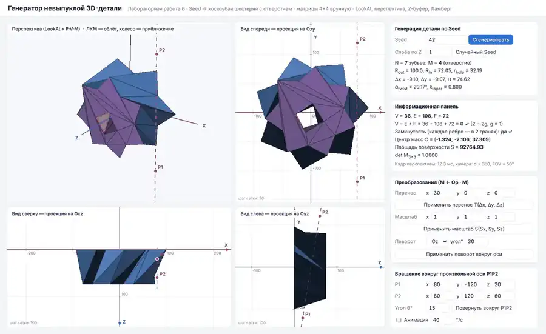
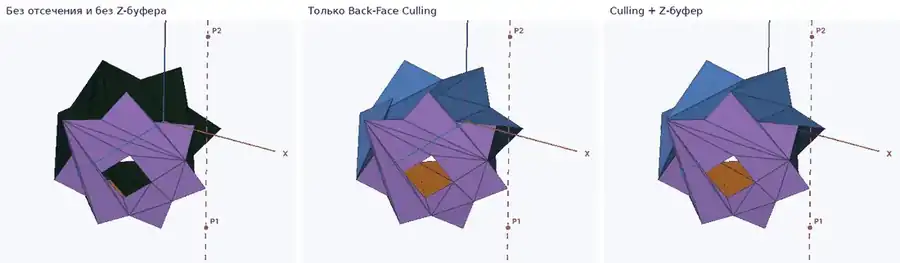
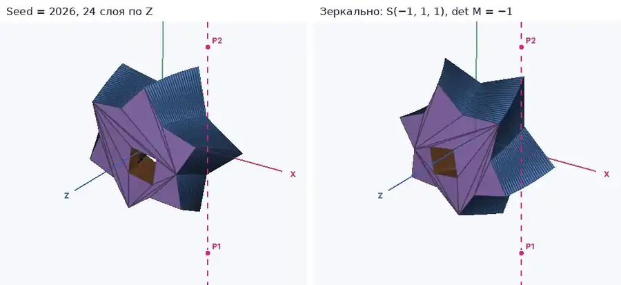

# Лабораторная работа 6 — генератор невыпуклой 3D-детали

**Приложение на C++17 / Qt 6** (проект для Visual Studio Code + CMake) и **веб-версия**.
По целому числу **Seed** процедурно строится косозубая шестерня (зубчатый фланец) со сквозным
отверстием, винтовой закруткой и конусностью. Деталь выводится в 4 окна: перспектива со свободной
камерой и три ортографические проекции. Вся математика (матрицы 4×4, однородные координаты,
LookAt, перспектива, нормали, Z-буфер, освещение) написана вручную, без графических движков.

**Веб-версия (работает в любом браузере на Windows и macOS):**
https://annagalimskaa-byte.github.io/Anna_Galimskaya_13_PCG/lab6_web/ — папка [`lab6_web`](../lab6_web).
Её же можно открыть локально двойным щелчком по `lab6_web/index.html`.
Генератор в обеих версиях одинаковый: один и тот же Seed даёт одну и ту же деталь с теми же V, E, F,
центром масс и площадью (сверено на 944 комбинациях Seed и числа слоёв).



## Описание работы

### Цель
Освоить построение полигональной модели с индексным буфером, аффинные преобразования в однородных
координатах (в том числе вращение вокруг произвольной оси), видовые и проекционные матрицы, а также
удаление невидимых поверхностей и плоское освещение.

### 1. Параметры из Seed
Генератор `Random(Seed)` (алгоритм Mulberry32, 32-битная арифметика, одинаково в C++ и JavaScript)
по очереди выдаёт параметры детали:

| Параметр | Диапазон | Смысл |
|---|---|---|
| N | {5, 6, 7, 8} | число зубьев внешнего контура |
| M | {3, 4, 5, 6} | число углов отверстия |
| R<sub>out</sub>, R<sub>in</sub> | 100; [55, 75] | радиусы вершин и впадин зубьев |
| r<sub>hole</sub> | [0.35; 0.55]·r<sub>вп</sub> | радиус отверстия (всегда < 0.6·R<sub>in</sub>) |
| Δx, Δy | \|Δ\| ≤ 0.85·r<sub>вп</sub> − r<sub>hole</sub> | смещение отверстия (деталь несимметрична) |
| H | [40, 80] | глубина выдавливания |
| α<sub>twist</sub> | [15°, 45°] | угол закручивания задней грани |
| k<sub>taper</sub> | [0.75, 0.95] | коэффициент сужения задней грани |

Здесь r<sub>вп</sub> — радиус окружности, вписанной в звезду: минимальное расстояние от центра до рёбер
`r_вп = R_out·R_in·sin(π/N) / √(R_out² + R_in² − 2·R_out·R_in·cos(π/N))`. Условие
`|Δ| + r_hole ≤ 0.85·r_вп` гарантирует, что отверстие никогда не пересечёт внешний контур
(проверено тестами для Seed от −500 до 3000).

### 2. Контуры передней грани (Z = 0)
- **Внешний контур:** круг делится на 2N секторов, радиус вершин чередуется R<sub>out</sub>, R<sub>in</sub>:
  `P_i = r_i·(cos φ_i, sin φ_i, 0)`, `φ_i = φ_0 + 2π·i / (2N)` — невыпуклая звезда из 2N вершин.
- **Отверстие:** правильный M-угольник радиуса r<sub>hole</sub>, сдвинутый на (Δx, Δy).

Оба контура обходятся против часовой стрелки.

### 3. Экструзия с закруткой и сужением (Z = H)
Каждая вершина копируется в плоскость Z = H, к копии применяется `T(0, 0, H) · Rz(α_twist) · S(k, k, 1)` —
масштаб k<sub>taper</sub> и поворот на α<sub>twist</sub> вокруг центра. Параметр **«Слоёв по Z»** (L) добавляет
промежуточные кольца с долей `t = j / L` масштаба и угла: при L = 1 деталь строится точно как в задании,
при L > 1 стенки превращаются в плавную винтовую поверхность (используется для проверки скорости при
увеличении детализации сетки).

### 4. Индексный буфер (триангуляция)
Вершины хранятся один раз (`Vertices`, однородные координаты `[x, y, z, 1]`), поверхность — тройками
индексов (`Triangles`), рёбра — уникальными парами (`Edges`). Обход каждого треугольника — против
часовой стрелки при взгляде снаружи:

- **внешние стенки:** неплоский четырёхугольник `F_i F_{i+1} B_{i+1} B_i` → `(F_i, F_{i+1}, B_{i+1})` и
  `(F_i, B_{i+1}, B_i)`; нормаль `(F_{i+1} − F_i) × (B_{i+1} − F_i)` смотрит наружу;
- **стенки отверстия:** обратный порядок `(F_k, B_{k+1}, F_{k+1})`, `(F_k, B_k, B_{k+1})` — нормали
  направлены к оси отверстия;
- **крышки:** многоугольник с дыркой режется **методом «отрезания ушей» (Ear Clipping)**.
  Самая правая вершина отверстия соединяется «мостом» с ближайшей видимой вершиной внешнего контура
  (мост не пересекает ни одного ребра), получается один простой многоугольник из 2N + M + 2 позиций
  (две вершины повторяются индексом, но не координатами). Затем по кругу ищется «ухо»: выпуклая вершина,
  в треугольнике которой нет других вершин, — треугольник отрезается. Получается ровно 2N + M
  треугольников. Передняя крышка (нормаль −Z) берётся с обратным обходом, задняя (+Z) — с прямым.

### 5. Самодиагностика: формула Эйлера–Пуанкаре
Деталь — замкнутая поверхность с одним сквозным отверстием (тор, род g = 1), поэтому
`V − E + F = 2 − 2g = 0`. Для одного кольца из `n = 2N + M` вершин и L слоёв:

```
V = (L + 1)·n
F = 2·L·n (стенки) + 2·n (две крышки) = 2·(L + 1)·n
E = 3F / 2 = 3·(L + 1)·n     (каждое ребро принадлежит ровно двум треугольникам)
V − E + F = (L + 1)·n·(1 − 3 + 2) = 0
```

Программа считает V, E, F по реальным массивам (E — число уникальных пар индексов) и дополнительно
проверяет **замкнутость**: каждое направленное ребро a→b встречается ровно один раз и ровно один раз
встречается обратное b→a (это заодно подтверждает согласованный обход граней).
Контрольный маркер: **центр масс** — среднее арифметическое вершин после текущей матрицы M, и
**площадь поверхности** — сумма `½·|(b − a) × (c − a)|` по всем треугольникам.

| Seed | N | M | R<sub>in</sub> | r<sub>hole</sub> | (Δx; Δy) | H | α | k | V | E | F | V−E+F | Центр масс | Площадь |
|---|---|---|---|---|---|---|---|---|---|---|---|---|---|---|
| 1 | 7 | 3 | 65.55 | 31.16 | (−2.37; −12.75) | 57.03 | 44.84° | 0.841 | 34 | 102 | 68 | 0 | (0.333; −1.920; 28.516) | 88346.84 |
| 7 | 5 | 3 | 74.54 | 36.30 | (1.10; 17.40) | 62.13 | 36.89° | 0.802 | 26 | 78 | 52 | 0 | (−0.757; 3.355; 31.067) | 82949.05 |
| 42 | 7 | 4 | 72.05 | 32.19 | (−9.10; −9.07) | 74.62 | 29.17° | 0.800 | 36 | 108 | 72 | 0 | (−1.324; −2.106; 37.309) | 92764.93 |
| 100 | 5 | 4 | 65.64 | 33.53 | (−7.29; −0.96) | 49.18 | 30.07° | 0.876 | 28 | 84 | 56 | 0 | (−1.770; −0.699; 24.590) | 72395.98 |
| 2026 | 6 | 4 | 68.22 | 30.33 | (6.07; −18.14) | 51.74 | 16.28° | 0.763 | 32 | 96 | 64 | 0 | (1.800; −3.766; 25.869) | 68909.05 |

## Конвейер преобразований

Используются векторы-столбцы: `v' = M·v`. Каждая новая операция умножается **слева**:
`M ← Op · M` — то есть применяется к уже преобразованной детали в мировых координатах.
Результирующая матрица M выводится в таблицу 4×4 в реальном времени, кнопка
«Сброс преобразований» возвращает M = E.

```
T(Δx,Δy,Δz) = | 1 0 0 Δx |   S(Sx,Sy,Sz) = | Sx 0  0  0 |   Rz(θ) = | cos θ −sin θ 0 0 |
              | 0 1 0 Δy |                 | 0  Sy 0  0 |           | sin θ  cos θ 0 0 |
              | 0 0 1 Δz |                 | 0  0  Sz 0 |           |   0      0   1 0 |
              | 0 0 0 1  |                 | 0  0  0  1 |           |   0      0   0 1 |
```
(Rx, Ry — аналогично.) Отрицательный коэффициент масштаба даёт зеркальное отражение (det M < 0).

### Вращение вокруг произвольной оси P1P2
Направляющий вектор `u = (P2 − P1) / ‖P2 − P1‖`. Используется матрица Родрига с переносом:

```
M_ось = T(P1) · R_u(θ) · T(−P1),     R_u(θ) = cos θ·E + (1 − cos θ)·u·uᵀ + sin θ·[u]×
```

Для контроля реализован и второй способ — совмещение оси с Oz:
`T(P1) · Rx⁻¹ · Ry⁻¹ · Rz(θ) · Ry · Rx · T(−P1)`, где Rx (cos = c/d, sin = b/d, d = √(b² + c²))
переводит u = (a, b, c) в плоскость Oxz, а Ry (cos = d, sin = −a) совмещает его с Oz. Обратные
повороты — транспонированные матрицы. Тесты подтверждают совпадение обоих способов (расхождение ~10⁻¹⁴).

**Пример** (значения по умолчанию): P1 = (80, −120, 20), P2 = (80, 120, 60), θ = 15°.
`‖P2 − P1‖ = 243.3105`, `u = (0, 0.986394, 0.164399)`.

```
R_u(15°) = |  0.9659  −0.0425   0.2553   0 |      M_ось = |  0.9659  −0.0425   0.2553   −7.4860 |
           |  0.0425   0.9991   0.0055   0 |              |  0.0425   0.9991   0.0055   −3.6250 |
           | −0.2553   0.0055   0.9668   0 |              | −0.2553   0.0055   0.9668   21.7499 |
           |  0        0        0        1 |              |  0        0        0         1      |
```

Левая верхняя 3×3 часть совпадает, а столбец переноса ненулевой — ось не проходит через начало
координат. Проверка: середина оси (80, 0, 40) после M<sub>ось</sub> остаётся на месте (80, 0, 40).
Ось P1P2 рисуется во всех окнах розовым пунктиром (участки, закрытые деталью, — бледнее), а флажок
«Анимация» непрерывно вращает деталь вокруг неё — видно, что вращение идёт строго вокруг этой прямой.

### Некоммутативность умножения матриц
Кнопка **«T·R ≠ R·T ?»** берёт перенос и поворот из полей панели и показывает оба произведения.
Для T(30, 0, 0) и Rz(30°):

```
T·R = | 0.866 −0.500 0  30.000 |        R·T = | 0.866 −0.500 0  25.981 |
      | 0.500  0.866 0   0.000 |              | 0.500  0.866 0  15.000 |
      | 0      0     1   0     |              | 0      0     1   0     |
      | 0      0     0   1     |              | 0      0     0   1     |
```
Точка (100, 0, 0): T·R → (116.603, 50, 0) — сначала повернули, потом сдвинули;
R·T → (112.583, 65, 0) — сначала сдвинули, потом повернули вокруг начала координат.
Повороты вокруг разных осей тоже не перестановочны: Rx(90°)·Ry(90°) ≠ Ry(90°)·Rx(90°)
(первая переводит (1, 0, 0) в (0, 1, 0), вторая — в (0, 0, −1)). Повороты вокруг одной оси
перестановочны: Rz(20°)·Rz(50°) = Rz(50°)·Rz(20°). Поэтому порядок в цепочке M ← Op·M важен,
и он показывается списком «Цепочка преобразований».

## Камера и проекции

- **LookAt:** `f = normalize(Target − Eye)`, `r = normalize(f × Up)`, `u = r × f`; строки матрицы вида —
  `r`, `u`, `−f` с переносом `−r·Eye`, `−u·Eye`, `f·Eye`.
- **Перспектива** (FOV, Aspect, Near, Far):
  ```
  | f/aspect 0  0                      0                     |      f = 1 / tan(FOV/2)
  | 0        f  0                      0                     |
  | 0        0  (Far+Near)/(Near−Far)  2·Far·Near/(Near−Far) |
  | 0        0  −1                     0                     |
  ```
- **Конвейер:** `clip = P·V·M·v` → отсечение по ближней плоскости (z ≥ −w) → **деление на w** →
  NDC [−1, 1] → пиксели: `x = (x_ndc + 1)/2·W`, `y = (1 − y_ndc)/2·H`.
- **Облёт камеры:** Eye лежит на сфере вокруг Target: `Eye = Target + d·(cos β·sin α, sin β, cos β·cos α)`;
  ЛКМ меняет углы α, β, колесо — расстояние d, Shift + колесо — угол обзора (FOV).
- **Ортографические виды:** спереди (Oxy, X вправо, Y вверх), сверху (Oxz, X вправо, Z вниз),
  слева (Oyz, Z вправо, Y вверх). Масштаб и центр подбираются автоматически по описанной сфере детали,
  началу координат и точкам P1, P2; на каждом виде — оси с подписями, сетка и её шаг.

## Удаление невидимых поверхностей и освещение

- **Back-Face Culling:** `N = (b − a) × (c − a)`; грань отбрасывается, если `N · V_cam ≤ 0`,
  где `V_cam = Eye − a` (в перспективе) или направление на наблюдателя (в ортографии).
  При **det M < 0** (зеркальное отражение, например Sx = −1) порядок обхода вершин на экране меняется
  на обратный, поэтому нормаль разворачивается: `N := −N`. Деталь остаётся непрозрачной и не
  «выворачивается» наизнанку.
- **Z-буфер:** для каждого пикселя хранится глубина NDC z; треугольник растеризуется по
  барицентрическим координатам, глубина интерполируется, пиксель пишется только если он ближе.
  Деталь невыпуклая и с отверстием, поэтому одного отсечения нелицевых граней мало:
  передние зубья перекрывают стенки отверстия и соседние зубья.
- **Плоское освещение (Ламберт):** `I = I_amb + (1 − I_amb)·max(0, N̂ · L̂)`, где `L̂` — единичный вектор
  от центра треугольника к точечному источнику света; положение источника задаётся в панели и
  отмечается жёлтым значком во всех окнах.





**Скорость.** Рендер полностью программный. При 200 слоях по Z (V = 3216, E = 9648, F = 6432)
кадр перспективы в браузере строится примерно за 30 мс, анимация остаётся плавной; C++ версия быстрее.

## Соответствие шкале оценивания

| Требование | Где реализовано |
|---|---|
| Процедурная генерация по Seed, единый буфер вершин и индексов | `mesh.cpp`: `paramsFromSeed`, `buildMesh` |
| Матрицы 4×4 и однородные координаты вручную | `math3d.cpp` (без сторонних математических классов) |
| Вращение вокруг оси P1P2 не через начало координат, ось на экране, матрица 4×4 в интерфейсе | `rotationAroundLine`, пунктир P1P2, таблица M |
| Три ортографические проекции с осями | `makeOrthoView`, сетка и подписи |
| Эйлер–Пуанкаре V − E + F = 0, центр масс | информационная панель, `computeStats` |
| Перспектива с делением на w, LookAt, облёт мышью | `lookAt`, `perspective`, `OrbitCamera` |
| Back-Face Culling с учётом CCW и Sx < 0 | `drawMesh`, `faceNormal` |
| Собственный Z-буфер | `Framebuffer::depth`, `rasterTriangle` |
| Flat Shading по Ламберту, свет настраивается | `drawMesh`, панель «Освещение» |
| Плавность при росте детализации, отчёт, некоммутативность | «Слоёв по Z» до 200, этот README, кнопка «T·R ≠ R·T ?» |

## Интерфейс

- **4 окна просмотра** обновляются синхронно: перспектива (большое) и три проекции.
- **Генерация:** Seed, «Сгенерировать», «Случайный Seed», «Слоёв по Z»; список параметров детали.
- **Информационная панель:** V, E, F, V − E + F, замкнутость, центр масс, площадь, det M, время кадра.
- **Преобразования:** перенос, масштаб (в т. ч. отрицательный), поворот вокруг Ox/Oy/Oz,
  поворот вокруг P1P2 на угол θ и анимация вокруг P1P2, таблица M, цепочка операций, сброс.
- **Отображение:** заливка/каркас, рёбра, Back-Face Culling, Z-буфер, освещение, цвета граней
  (синий — внешние стенки, оранжевый — отверстие, зелёный — передняя грань Z = 0,
  фиолетовый — задняя Z = H), ось P1P2, оси координат, положение источника света.
- **Камера:** FOV, Near, Far, сброс; ЛКМ — облёт, колесо — приближение, Shift + колесо — FOV.

## Сборка и запуск в Visual Studio Code

### macOS
1. Установить Qt и CMake: `brew install qt cmake` (путь `/opt/homebrew/opt/qt` уже прописан в `CMakeLists.txt`).
2. В VS Code установить расширения **C/C++** и **CMake Tools** (VS Code сам предложит их из `.vscode/extensions.json`).
3. *File → Open Folder…* → папка `lab6`. CMake Tools сконфигурирует проект (выбрать компилятор Clang).
4. В строке состояния выбрать цель **`lab6_3d_part`** и нажать ▶ (Run) — откроется окно приложения.

Из терминала:
```bash
cd lab6
cmake -S . -B build -DCMAKE_BUILD_TYPE=Release
cmake --build build -j
open build/lab6_3d_part.app        # macOS
./build/lab6_tests                 # модульные тесты
```

### Windows
1. Установить Qt 6 (компонент *MinGW 64-bit*) и CMake.
2. В `.vscode/settings.json` в `cmake.configureSettings` добавить
   `"CMAKE_PREFIX_PATH": "C:/Qt/6.8.0/mingw_64"` (свой путь к Qt).
3. Открыть папку `lab6`, выбрать комплект MinGW, цель `lab6_3d_part`, ▶.

Без Qt собираются ядро, тесты (`lab6_tests`) и `lab6_render_demo` (рендер 4 видов в файл PPM без GUI).

**Модульные тесты** (`tests/unit_tests.cpp`, 176 проверок): базовые матрицы, некоммутативность,
совпадение формулы Родрига и композиции поворотов для разных осей и углов, неподвижность точек оси,
LookAt и перспектива (near → −1, far → +1, w = −z), диапазоны параметров и V − E + F = 0 для Seed
от −500 до 3000 (L = 1 и 4), замкнутость и внешняя ориентация граней (положительный объём),
площадь триангуляции крышки, центр масс и площадь после преобразований, отсечение граней
при Sx = −1, независимость результата Z-буфера от порядка граней. Все тесты пройдены.

## Структура

```
include/, src/
  math3d.*           векторы, матрицы 4x4, T/S/R, Родриг, ось P1P2, LookAt, перспектива, ортография
  mesh.*             Random(Seed), параметры, контуры, Ear Clipping, сборка детали, V/E/F, Эйлер, центр масс
  renderer.*         P·V·M, отсечение по near, деление на w, растеризация, Z-буфер, Culling, Ламберт, камеры
  scene.h            общее состояние: деталь, M, история, ось P1P2, камера, настройки
  viewport_widget.*  окно просмотра Qt (вывод буфера, сетка, оси, подписи, мышь)
  main_window.*      главное окно Qt и панель управления
  main.cpp           точка входа
tests/               модульные тесты
tools/render_demo.cpp  рендер без GUI (проверка и скриншоты)
docs/screenshots/    скриншоты для README
.vscode/             настройки VS Code (CMake Tools, отладка)
../lab6_web/         веб-версия (index.html, math3d.js, mesh.js, renderer.js — тот же алгоритм)
```

## Выводы
- Индексная модель (уникальные вершины + тройки индексов) позволяет строго проверить топологию:
  для детали со сквозным отверстием V − E + F = 0 при любом Seed и любой детализации.
- Любое преобразование детали сводится к одной матрице 4×4; вращение вокруг произвольной оси —
  композиция переноса и поворота, формула Родрига и пошаговое совмещение оси с Oz дают одну и ту же матрицу.
- Умножение матриц некоммутативно, поэтому порядок операций в цепочке определяет результат.
- Для невыпуклой детали с отверстием отсечения нелицевых граней недостаточно; Z-буфер корректно
  решает перекрытия, а освещение по Ламберту делает форму (закрутку и конусность) хорошо читаемой.
